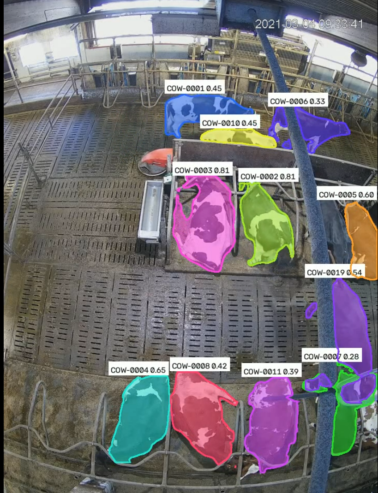
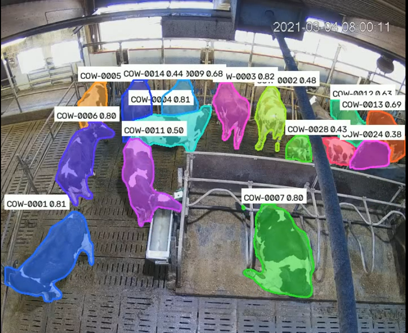
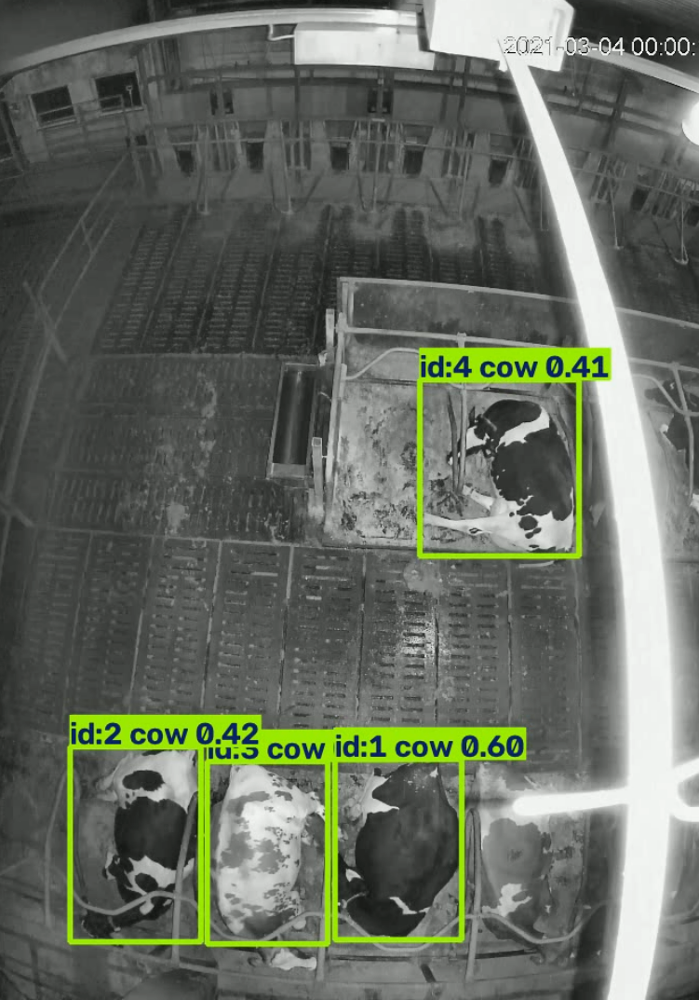

# SmartBarn-Vision-Cow-Tracking-and-Instance-Segmentation

**AI-powered dairy-barn video analytics: YOLO cow detection, multi-object tracking, experimental identity recovery, virtual-zone monitoring, movement analysis, simulated robot-path alerts, and pixel-level instance segmentation.**

    

> **Independent research prototype:** Inspired by practical challenges in automated dairy farming; **not affiliated with, endorsed by, or a reproduction of Lely systems**. Cow IDs are temporary tracking IDs, not real animal identities. Behaviour and safety outputs are experimental estimates; the robot-path component is **not suitable for controlling physical robots**. CPU inference is supported, but real-time performance has not been demonstrated.

## 🎯 Overview

**SmartBarn Vision** processes fixed-camera dairy-barn footage into annotated videos and structured datasets. The project combines pretrained YOLO models, ByteTrack/BoT-SORT, image preprocessing, simple appearance-and-motion identity association, geometric monitoring zones, and OpenCV visualization. A separate **YOLO11 instance-segmentation pipeline** generates an individual colored mask for each detected cow and exports pixel-level instance-ID maps.

The implementation is modular: each feature lives in a separate Python module and can be tested independently in Jupyter. **No training from scratch is required for the pretrained detection and segmentation demos.** Reliable standing/lying classification requires an optional separately trained posture model.

## Results / Screenshots
### Individual cow instance mask

and also another view of instance mask


### simple model of cow detection in dark area which the related code is in folder "extera"



## Key features

| Capability | Implementation | Output / benefit |
| --- | --- | --- |
| Cow detection | Pretrained YOLO11 detection, COCO `cow` class | Cow bounding boxes and confidence scores |
| Multi-object tracking | ByteTrack, with configurable tracker | Frame-to-frame track IDs |
| Experimental identity recovery | Appearance histogram + motion/position matching | Attempts to reconnect fragmented tracks after short occlusions |
| Adaptive preprocessing | Original/contrast-enhanced frames, optional CLAHE | Helps explore difficult low-light or monochrome footage |
| Virtual barn zones | Configurable normalized polygons | Zone occupancy, entry/exit events, dwell-time estimates |
| Movement/activity proxy | Tracked image-coordinate motion | Motion or low-motion indicators in pixels/second |
| Optional posture recognition | User-supplied trained classification checkpoint | Standing/lying predictions when compatible weights are available |
| Simulated robot-route monitoring | Image-space proximity and short-horizon trajectory extrapolation | Visualization-only proximity/collision warnings |
| **Cow instance segmentation** | **YOLO11n-seg + BoT-SORT** | **One colored pixel mask per detected cow** |
| Instance-ID map | Confidence-priority overlap resolution | 16-bit PNG: `0` background, nonzero temporary cow instance ID |
| Per-cow binary masks | OpenCV mask export | Individual black-and-white PNGs |
| Export and playback | CSV, OpenCV MP4, FFmpeg H.264 | Structured outputs and browser-friendly videos |

**Instance segmentation vs semantic segmentation:** All detected cows have the same semantic class (`cow`), but each detected cow has its **own instance mask and track ID**. This is not full panoptic segmentation: other barn objects and background categories are not segmented. If two masks overlap, the exported ID map assigns the shared pixel to the higher-confidence instance; this does **not** recover hidden body parts.


## Repository structure

```text
SmartBarn-Vision/
├── README.md
├── requirements.txt
├── .gitignore
├── run_demo.py
├── smartbarn/
│   ├── __init__.py
│   ├── config.py                 # Detection-pipeline settings and zone polygons
│   ├── preprocessing.py          # Adaptive contrast enhancement
│   ├── detection.py              # YOLO detection and tracking
│   ├── identity.py               # Experimental occlusion/ID recovery
│   ├── zones.py                  # Zone monitoring
│   ├── behavior.py               # Movement and optional posture classification
│   ├── safety.py                 # Simulated robot-path monitoring
│   ├── visualization.py          # Bounding boxes, labels and overlays
│   ├── video_utils.py           # Video conversion utilities
│   ├── pipeline.py              # Combined detection pipeline
│   └── segmentation.py          # Per-cow instance segmentation
├── notebooks/
│   └── SmartBarn_Instance_Segmentation.ipynb
├── output-screenshot/            # Add your own screenshots
├── videos/                       # Local source videos; 
├── models/                       # Downloaded or custom weights;
└── outputs/                      # Generated videos, CSVs and masks; 
```

The `videos/`, `models/`, `outputs/` and `output-screenshot/` directories may be empty or absent in a fresh clone. Create them as needed.

## Requirements

- Python **3.10+**; Jupyter Notebook or JupyterLab.
- CPU supported (`device="cpu"`). GPU use requires a compatible PyTorch/CUDA installation.
- Enough disk space for video files and potentially thousands of per-frame mask PNGs.
- Internet access for the first download of Ultralytics model weights.

```bash
python -m pip install -r requirements.txt
jupyter lab
```

If your installation does not already have the segmentation dependencies, use:

```bash
python -m pip install "ultralytics>=8.3,<9" "opencv-python>=4.8" "numpy>=1.26" pandas matplotlib imageio-ffmpeg ipython jupyterlab
```

## Quick start

1. Clone the repository and open a terminal **in the project root**.
2. Install dependencies using the command above.
3. Place a video at `videos/cows.mp4`, or edit the `video` path in the notebook configuration.
4. Open `notebooks/SmartBarn_Demo.ipynb` for detection, zones, activity and robot-path simulation; open `notebooks/SmartBarn_Instance_Segmentation.ipynb` for pixel-level cow masks.
5. Run notebook cells in order and inspect generated files under `outputs/`.

### A. Detection, zone monitoring and activity

```python
from smartbarn.config import Config
from smartbarn.pipeline import SmartBarnPipeline

cfg = Config(
    video="videos/cows.mp4",
    output_dir="outputs/demo",
    weights="yolo11n.pt",
    device="cpu",
    max_seconds=10,
    enhancement="auto",
    use_identity_recovery=True,
    use_zones=True,
    use_behavior=True,
    use_safety=True,
)
SmartBarnPipeline(cfg).run()
```

The example polygons and robot path in `smartbarn/config.py` are **placeholders**. Adjust them to your actual camera view before interpreting events. To run directly from a terminal:

```bash
python run_demo.py
```

### B. Per-cow instance segmentation

```python
from smartbarn.segmentation import SegmentationConfig, CowInstanceSegmenter

cfg = SegmentationConfig(
    video="videos/cows.mp4",
    output_dir="outputs/segmentation",
    weights="yolo11n-seg.pt",
    tracker="botsort.yaml",
    device="cpu",
    conf=0.15,
    imgsz=960,
    max_side=960,
    max_seconds=10,
    enhancement="auto",
    save_individual_masks=True,
    save_instance_maps=True,
    h264=True,
)
results = CowInstanceSegmenter(cfg).process_video()
print(results)
```

Display the H.264 output in Jupyter:

```python
from IPython.display import Video, display

display(Video(filename=str(results["video"]), embed=True, width=850))
```

**Running from Jupyter:** Start Jupyter from the repository root so Python can import the `smartbarn` package. If the notebook runs with `notebooks/` as its working directory, change to the project root or add it to `sys.path`.

## Pretrained models

| Checkpoint | Purpose | Training required for demo? |
| --- | --- | --- |
| `yolo11n.pt` | COCO cow detection (class ID `19`) | No |
| `yolo11n-seg.pt` | COCO cow instance segmentation | No |
| Custom posture-classifier `.pt` | Standing/lying classification | **Yes**, unless you already have compatible trained weights |

Ultralytics downloads standard checkpoints automatically when first requested. Check checkpoint licensing and terms before commercial use or redistribution. **Do not commit pretrained `.pt` files unless their redistribution terms permit it.**


## Technical notes and limitations

- **Touching or overlapping cows:** Instance segmentation predicts separate visible masks when the model can distinguish the animals; heavy occlusion can still cause missed or merged instances.
- **Temporary IDs:** BoT-SORT and ByteTrack IDs are session-local and are **not ear-tag identities**. BoT-SORT does not automatically imply a trained cow re-identification model.
- **Identity recovery:** Histogram/motion matching is heuristic and may incorrectly associate visually similar animals. It is implemented in the detection workflow, **not automatically in the segmentation workflow**.
- **Behaviour:** Zone occupancy is not proof of feeding; low motion is not proof of lying, resting or illness. A standing/lying label requires a suitable trained classifier.
- **Perspective:** Image-space speed and safety distances are measured in pixels, not meters. Physical estimates require camera calibration and ground-plane mapping.
- **Safety:** The robot-route module is a visualization/simulation only, **not a safety-certified system**.
- **Performance:** CPU inference can be slow, especially at `imgsz=960`. Start with a 10-second clip and use `max_side=960` or smaller.
- **Annotation and validation:** No formal benchmark or numerical accuracy claim is supplied. Use labelled evaluation footage before making performance claims.

## Future improvements

- Fine-tune YOLO11-seg on **manually labelled overhead dairy-cow masks**.
- Evaluate learned animal-specific re-identification embeddings and occlusion recovery.
- Integrate instance masks directly with zone and activity monitoring.
- Add a calibrated bird's-eye ground-plane transform for physical movement estimates.
- Train and validate a temporal standing/lying/feeding classifier.
- Add an interactive review tool for correcting masks and track IDs.
- Benchmark CPU/GPU throughput, memory, mask mAP and IDF1/HOTA on held-out data.

## Acknowledgments

Built with [Ultralytics YOLO](https://github.com/ultralytics/ultralytics), [OpenCV](https://opencv.org/), [NumPy](https://numpy.org/), [pandas](https://pandas.pydata.org/) and [FFmpeg](https://ffmpeg.org/). This is an independent portfolio/research project; no affiliation with Lely is claimed.

## 💡 Final note

Thank you for exploring **SmartBarn Vision**! Contributions, reproducible experiments and suggestions for improving cow segmentation, tracking and behaviour analysis are welcome. 🐄
